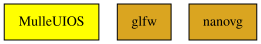

# MulleUIOS

#### 💻📱 MulleUIOS provides platform/OS specifica


# MulleUIOS

#### 💻📱 MulleUIOS provides platform/OS specifica


===
MEMO: This is actually MulleUIOSGLFWNanoVG or so, there needs to be another
      project called MulleUISDLNanoVG or MulleUISDLSkia that mixes backend
      and drawing library. (Or use different configs ?)
===

This project ties the underlying window system, graphics context and drawing
library together. In theory this could be on top of some kind of ncurses
windowing, with an ASCII renderer. But in practicality it's probably this:

OS      | Windows | Drawing      | State
--------|---------|--------------|-------
android | ???     | nanovg       | Planned
darwin  | GLFW    | nanovg.metal | Experimental
ios     | ???     | nanovg.metal | Planned
linux   | GLFW    | nanovg.gl3   | Works
windows | GLFW    | nanovg.gl3   | Works
windows | SDL2    | nanovg.d3d11 | Planned


The project itself is relatively bare, except for glue code. For instance
CALayer is made a UILayer in MulleUIOS.

Also this project contains quite a few leak and functionality tests.


| Release Version                                       | Release Notes  | AI Documentation
|-------------------------------------------------------|----------------|---------------
|  [](//github.com/MulleUI/MulleUIOS/actions) | [RELEASENOTES](RELEASENOTES.md) | [DeepWiki for MulleUIOS](https://deepwiki.com/MulleUI/MulleUIOS)


## Configuration

MulleUIOS selects its window system, renderer and backend at build time via
**sourcetree configs**. The three dimensions are orthogonal:

```
Window system  : MulleGLFW, MulleSDL, (none/headless)
Renderer core  : MulleCGNanovg, (MulleCGCairo — planned)
Backend        : MulleCGNanovgGL, MulleCGNanovgD3D11 (planned)
```

### Sourcetree Config

```sh
mulle-sde config switch glfw        # GLFW + OpenGL/nanovg (default)
mulle-sde config switch sdl         # SDL2 + OpenGL/nanovg
mulle-sde config switch sdl-d3d11   # SDL2 + Direct3D 11 (Windows, planned)
```

Config       | Window    | Renderer      | Backend          | Status
-------------|-----------|---------------|------------------|--------
`glfw`       | MulleGLFW | MulleCGNanovg | MulleCGNanovgGL  | Works
`sdl`        | MulleSDL  | MulleCGNanovg | MulleCGNanovgGL  | Works
`sdl-d3d11`  | MulleSDL  | MulleCGNanovg | MulleCGNanovgD3D11 | Planned
`sdl-cairo`  | MulleSDL  | MulleCGCairo  | (image built-in) | Planned
`cairo`      | (none)    | MulleCGCairo  | (image built-in) | Planned

### GLFW Display Backend (Linux)

GLFW itself has sub-configs for the display system. The default is X11.
To use Wayland:

```sh
mulle-sde -f config switch -d MulleGLFW wayland
mulle-sde craft
```

Restore X11:

```sh
mulle-sde -f config switch -d MulleGLFW x11
mulle-sde craft
```

### Windows Cross-Compilation

To build for Windows (requires MinGW cross-compiler and Wine for testing):

```sh
mulle-sde env set MULLE_CRAFT_PLATFORMS '${MULLE_UNAME}:windows'
mulle-sde env set MULLE_SOURCETREE_PLATFORMS '${MULLE_UNAME}:windows'
mulle-sde env set MULLE_CRAFT_TOOLCHAIN__WINDOWS 'toolchain--linux-windows--x86_64-w64-mingw32--mulle-clang'
mulle-sde env set MULLE_CRAFT_CROSS_COMPILER_ROOT__WINDOWS '/opt/mulle-clang-project-windows/latest'
mulle-sde env set MULLE_EMULATOR__WINDOWS 'WINEDEBUG=fixme-all,err-all wine'
mulle-sde craft
```

### Anti-Aliasing

Controlled by `UIWindowStyleAntiAlias` in the window styleMask (on by default
via `UIWindowStyleMaskDefault`). The actual mode depends on the platform:

Platform        | Mode
----------------|----------------------------------------------
Linux/GLES      | EdgeAA (software nanovg — MSAA not available with GLES)
Windows/GL      | MSAA4 (hardware, via GLFW)

To disable anti-aliasing:

```objc
styleMask = UIWindowStyleMaskDefault & ~UIWindowStyleAntiAlias;
```

To force software EdgeAA regardless of platform:

```objc
styleMask = (UIWindowStyleMaskDefault & ~UIWindowStyleAntiAlias)
          | UIWindowStyleForceEdgeAntiAlias;
```

### You are here




## Add

Use [mulle-sde](//github.com/mulle-sde) to add MulleUIOS to your project:

``` sh
mulle-sde add github:MulleUI/MulleUIOS
```

To only add the sources of MulleUIOS with dependency
sources use [clib](https://github.com/clibs/clib):


``` sh
clib install --out src/MulleUI MulleUI/MulleUIOS
```

Add `-isystem src/MulleUI` to your `CFLAGS` and compile all the sources that were downloaded with your project.


## Install

Use [mulle-sde](//github.com/mulle-sde) to build and install MulleUIOS and all dependencies:

``` sh
mulle-sde install --prefix /usr/local \
   https://github.com/MulleUI/MulleUIOS/archive/latest.tar.gz
```

### Legacy Installation

Install the requirements:

| Requirements                                 | Description
|----------------------------------------------|-----------------------
| [MulleUICore](https://github.com/MulleUI/MulleUICore)             | 🌀 UI for mulle-objc - Desktop and Mobile
| [MulleCGNanovg](https://github.com/MulleUI/MulleCGNanovg)             | 🛸 MulleCGNanovg does something
| [MulleCGNanovgGL](https://github.com/MulleUI/MulleCGNanovgGL)             | 🛸 MulleCGNanovgGL does something
| [MulleGLFW](https://github.com/MulleUI/MulleGLFW)             | 🌐 MulleGLFW provides platform windows and events
| [mulle-objc-list](https://github.com/mulle-objc/mulle-objc-list)             | 📒 Lists mulle-objc runtime information contained in executables.

Download the latest [tar](https://github.com/MulleUI/MulleUIOS/archive/refs/tags/latest.tar.gz) or [zip](https://github.com/MulleUI/MulleUIOS/archive/refs/tags/latest.zip) archive and unpack it.

Install **MulleUIOS** into `/usr/local` with [cmake](https://cmake.org):

``` sh
PREFIX_DIR="/usr/local"
cmake -B build                               \
      -DMULLE_SDK_PATH="${PREFIX_DIR}"       \
      -DCMAKE_INSTALL_PREFIX="${PREFIX_DIR}" \
      -DCMAKE_PREFIX_PATH="${PREFIX_DIR}"    \
      -DCMAKE_BUILD_TYPE=Release &&
cmake --build build --config Release &&
cmake --install build --config Release
```


## Author

[Nat!](https://mulle-kybernetik.com/weblog) for Mulle kybernetiK  


